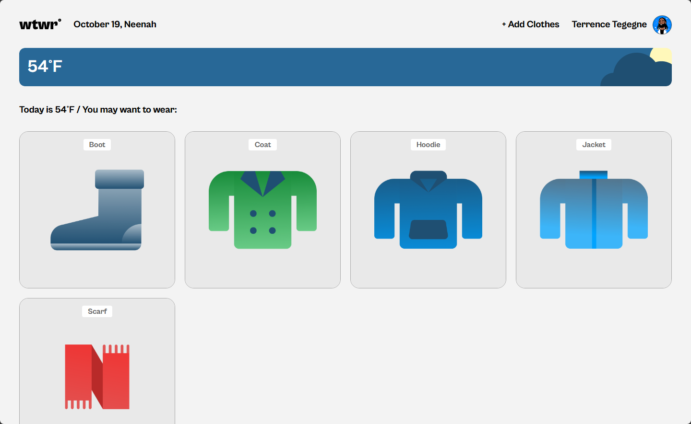
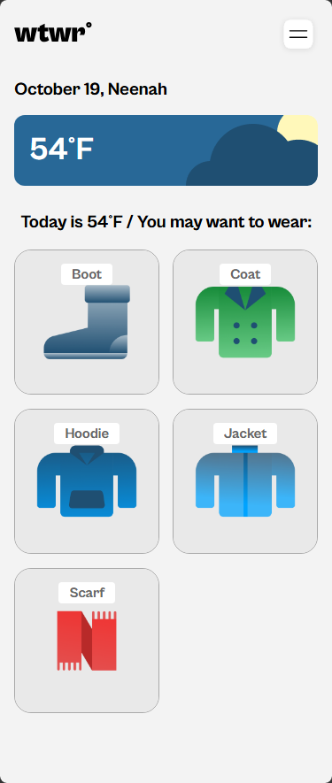

# Project 4: WTWR (What to Wear?)

## What is WTWR?

WTWR (What to Wear?) is the 4th project through [TripleTen](https://tripleten.com/), a weather-based clothing recommendation application designed to help users decide what to wear based on the current weather conditions.

The application retrieves weather data from the [OpenWeatherMap API](https://openweathermap.org/api) and displays the current temperature, weather conditions, and recommended clothing items.

Users can browse clothing recommendations for hot, warm, and cold weather, view individual garments, and add new clothing items through a form.

Currently, WTWR primarily serves as a front-end application. Clothing items are managed through React state and are not saved between page reloads. Additional functionality may be added in future updates.

**Rendered on a 1440p display:**<br>


**Rendered on a 375p display:**<br>


### How was it built?

WTWR consists of several main components:

- **Header**
  - Displays the current date and location.
  - Provides navigation controls and an option to add clothing items.
  - Uses React state to manage the responsive navigation menu.

- **Weather Card**
  - Retrieves current weather data through the OpenWeatherMap API.
  - Displays the current temperature and a corresponding weather illustration.
  - Selects illustrations based on the weather conditions and time of day.

- **Clothing Cards**
  - Uses React to dynamically render clothing items.
  - Filters recommendations according to the current weather category.
  - Allows users to select individual garments to view additional details.

- **Modals and Forms**
  - Uses reusable modal components for adding clothing items and viewing garment details.
  - Implements form validation for garment names and image URLs.
  - Supports closing modals through the close button, clicking outside the modal, or pressing Escape.

The project was built using **React, JavaScript, HTML, and CSS**, with Vite providing the development environment and build tooling.

React state and props are used to manage application data and pass information between components. CSS handles the layout, responsive styling, and visual presentation, while component-specific stylesheets help keep the code organized.

### What I learned

This project provided practical experience working with React and component-based development, including:

- Managing state with `useState` and handling side effects with `useEffect`.
- Passing data and event handlers between parent and child components through props.
- Rendering lists dynamically using JavaScript's `map()` and filtering data with `filter()`.
- Retrieving and processing external API data using `fetch()` and Promises.
- Implementing controlled form inputs and validation.
- Creating reusable components and organizing stylesheets using BEM naming conventions.
- Managing source code with Git and GitHub.

### See it for yourself!

You can view the application through my [GitHub Pages deployment](https://O-P-E-N-B-A-L-L.github.io/se_project_react/).

### Running the project locally

To run WTWR on your local machine:

1. Clone the repository:

   ```bash
   git clone https://github.com/O-P-E-N-B-A-L/se_project_react.git
   ```

2. Navigate to the project directory:

   ```bash
   cd se_project_react
   ```

3. Install the dependencies:

   ```bash
   npm install
   ```

4. Start the development server:

   ```bash
   npm run dev
   ```

Vite will provide a local URL where you can view the application in your browser.

An OpenWeatherMap API key is required to retrieve weather data. Configure the API key before running the application, and avoid committing private credentials to a public repository.
